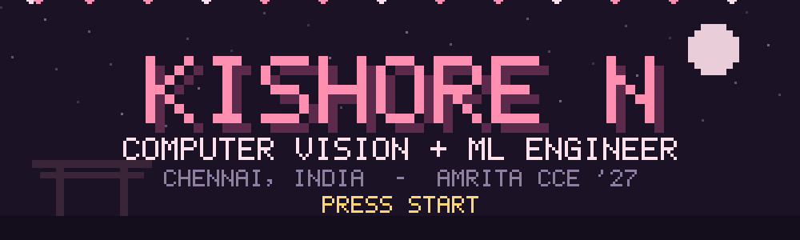
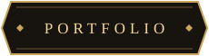
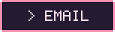
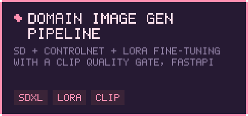
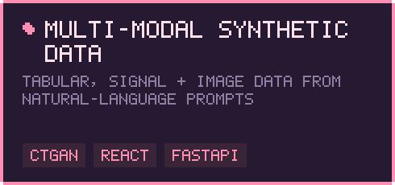
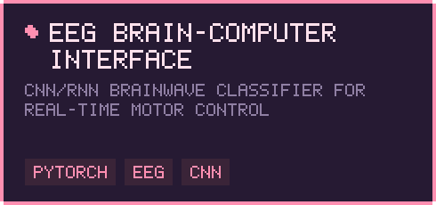
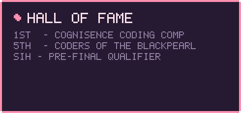

<!-- TODO: replace https://YOUR-PORTFOLIO-URL with your deployed portfolio (e.g. the Vercel URL) -->

  

I build computer-vision and generative-AI pipelines end to end, from EEG brain-computer interfaces 
to Stable Diffusion + LoRA image synthesis served over FastAPI. Final-year CCE @ Amrita, Chennai.

 

## 🌸 Level select

<!-- TODO: point each link at the matching repository -->

## 🕹️ Arcade

<picture>
  <source media="(prefers-color-scheme: dark)" srcset="https://raw.githubusercontent.com/Kishore-suthersingh/Kishore-suthersingh/output/snake-dark.svg"/>
  <source media="(prefers-color-scheme: light)" srcset="https://raw.githubusercontent.com/Kishore-suthersingh/Kishore-suthersingh/output/snake-light.svg"/>
  
</picture>

Title screen, player card and buttons are drawn by <code>scripts/gen.py</code> in a hand-made 5×7 pixel font and refreshed daily.

