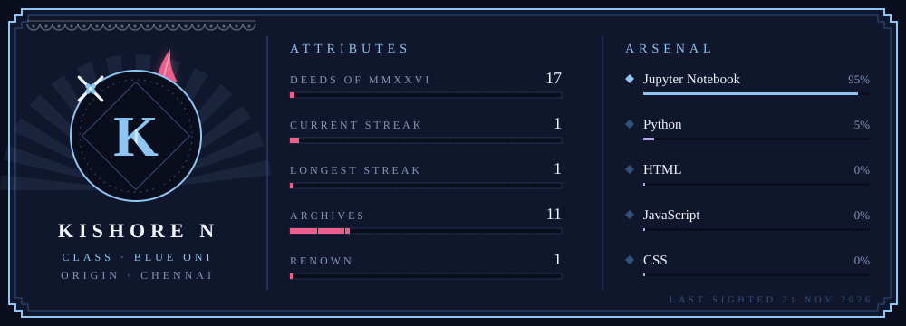
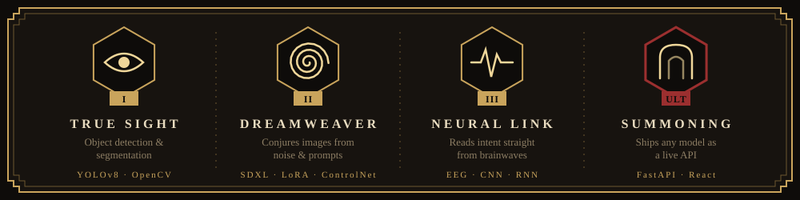
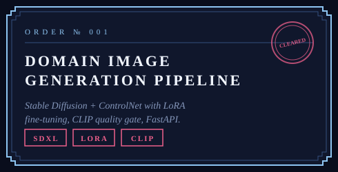
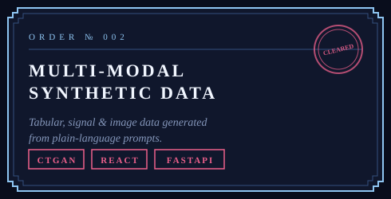
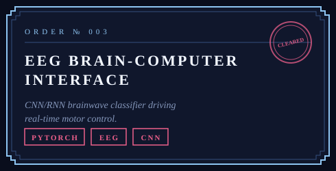
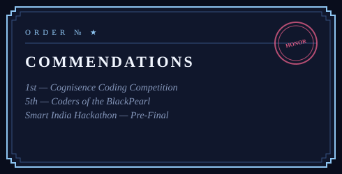

<!-- TODO: replace https://YOUR-PORTFOLIO-URL with your deployed portfolio (e.g. the Vercel URL) -->

  

<i>Computer-vision and generative-AI engineer. I build pipelines end to end, from EEG brain-computer 
interfaces to Stable Diffusion + LoRA image synthesis served over FastAPI. Final-year CCE at Amrita, Chennai.</i>

  

### ◆ &nbsp; O R D E R S &nbsp; ◆

<!-- TODO: point each link at the matching repository -->

### ◆ &nbsp; T H E &nbsp; H U N T &nbsp; ◆

<picture>
  <source media="(prefers-color-scheme: dark)" srcset="https://raw.githubusercontent.com/Kishore-suthersingh/Kishore-suthersingh/output/snake-dark.svg"/>
  <source media="(prefers-color-scheme: light)" srcset="https://raw.githubusercontent.com/Kishore-suthersingh/Kishore-suthersingh/output/snake-light.svg"/>
  
</picture>

Every panel here is drawn by <code>scripts/gen.py</code> and refreshed daily by a GitHub Action.

